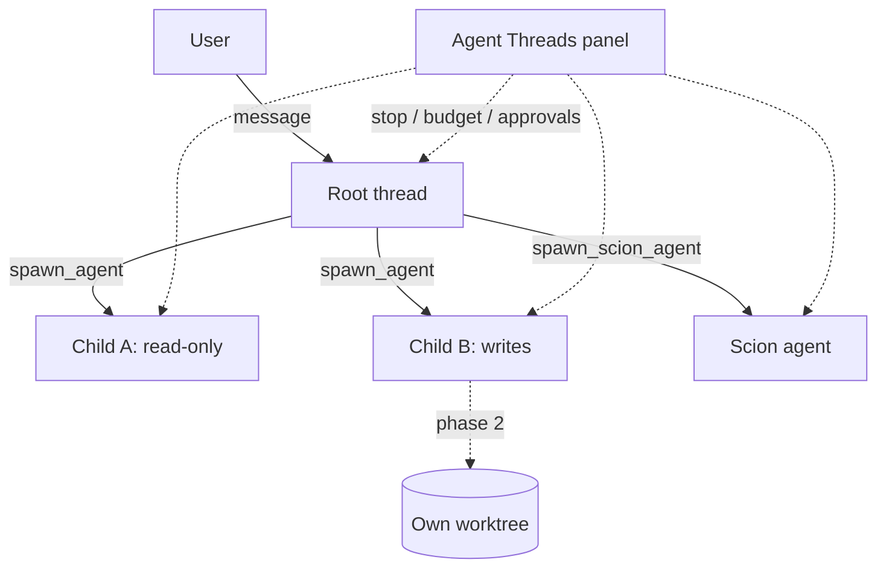

# AGENT SWARMS — see, stop and pay for many agents at once

> **Status:** design, drafted 2026-10-19. **Not in v0.3.0**: the build starts after
> the Monday 26 October launch. "Agent swarms" is a working title only; the name is
> Jay's to choose (see [Open questions](#open-questions)).

## The gap

PaddleBoard can already **run** a swarm. A model that calls `spawn_agent` several
times in one turn gets several child agents working at once, each on its own
model and persona, and the Agent Threads panel draws them as a tree. What it
cannot do is **manage** one. Nothing caps how many children start, nothing stops
a runaway child short of cancelling its parent, nothing adds up what a swarm
cost, and children that write files share the user's working tree with nothing
but a line in the prompt asking them to stay out of each other's way.

The more agents run, the more these gaps cost. Ten agents waiting on ten approval
prompts, or burning through an API budget in parallel, is the moment a user wants
one place to see everything and one button to stop it.

## What already exists

Checked against `main` on 2026-10-19 (read-only inventory, key claims re-verified
by hand).

| Need | Status | Where |
|---|---|---|
| Parallel child agents | ✅ | `spawn_agent` (`crates/agent/src/tools/spawn_agent_tool.rs`); tool calls in one turn run concurrently as a `FuturesUnordered` (`thread.rs`, `run_turn_internal`) |
| Per-child model and persona | ✅ | `spawn_agent`'s `model` (native ids only) and `persona`; `subagent_model` setting for the default |
| Child result back to the parent | ✅ | the parent awaits and receives `{session_id, output}`, the child's final message |
| A tree of every agent | ✅ | Agent Threads panel, `crates/agent_ui/src/orchestration_panel.rs` (`cmd-k cmd-g`); rows ranked `WaitingForConfirmation > RunningTools > Generating > Idle` |
| Cancel cascades to children | ✅ | `Thread::cancel` drains `running_subagents` and cancels each |
| Isolated agents (container + worktree) | ✅ opt-in | Scion: `spawn_scion_agent`, `crates/paddleboard_scion` (start, stop incl. `--all`, logs, sync); panel rows offer View Logs, Sync Changes, Stop Agent |
| External agents side by side | ✅ | ACP threads (Claude Code, Codex, …) appear in the same tree; they cannot be spawned by `spawn_agent` |
| Usage per agent | ✅ tokens | `paddleboard_usage::record` per (provider, model, session); `Session` granularity gives each child its own bucket |
| Sibling thread in a new worktree | ⚠️ staff only | `create_thread` with `use_new_worktree`, gated by `CreateThreadToolFeatureFlag`; fire-and-forget, no result to the caller |
| **Stop one native agent, a tree, or everything from the panel** | ❌ | only Scion rows have Stop; native rows have none |
| **Concurrency cap, child timeout, child count** | ❌ | none; in-process children have no timeout |
| **Budget per swarm (tokens or dollars)** | ❌ | none; usage is tokens only, with no prices |
| **Cost rolled up per swarm** | ❌ | per-session buckets exist; nothing sums a tree, and the panel shows no usage |
| **One queue for pending approvals** | ❌ | a row is flagged, but each prompt is answered in its own thread |
| **Write isolation for in-process children** | ❌ | children share the parent's worktree |
| **Depth beyond one level** | ❌ | `MAX_SUBAGENT_DEPTH: u8 = 1` (`thread.rs`); the tool is not registered on children |
| **Agents coordinating with each other** | ❌ | no messages between siblings, no shared board, no handle to another agent |

## Principles

1. **Manage before you multiply.** Nothing that lets agents spawn more agents
   (deeper nesting, an orchestrator mode) ships before every agent can be seen,
   stopped and budgeted. Phase 1 comes first for that reason, not because it is
   smallest.
2. **Every agent visible, every agent stoppable.** If it is running, it is a row
   in the Agent Threads panel, and the row has a stop control. That includes Scion
   and external agents, not only native ones.
3. **The user owns the spend.** Limits are settings the user chooses. Hitting a
   budget stops or asks, by the user's choice; it never silently carries on, and
   it never silently kills work either. Same rule as Spotter's escalation.
4. **Read-only by default; writers get isolation.** The rule set for fan-out on
   2026-10-06 ("read-only by default, no parallel pushes", every finding
   re-verified) becomes product behaviour: a child that can edit files gets its
   own worktree, and its changes come back for review rather than landing in the
   user's tree.
5. **Small models get small jobs.** An orchestrator that plans and delegates
   needs a strong model; the workers it starts can be cheap and narrow. A small
   model handed spawning power will take the shortcut (the Flamel and Gemma
   lessons), so delegation depth stays capped and visible.
6. **Fork-owned crates, tiny hooks.** Logic lives in new `paddleboard_swarm*`
   crates (working name). `thread.rs`, `spawn_agent_tool.rs` and
   `orchestration_panel.rs` get small, tagged call sites so the weekly upstream
   merge stays mechanical.
7. **Nothing leaves the machine that didn't before.** Swarms run where agents
   already run. A hosted swarm runner is out of scope here; `SCION_HUB.md` covers
   the hosted path separately.

## The design

A **swarm** is a root thread plus everything it started: its `spawn_agent`
children, and later their children, and any Scion agents it launched. The swarm
is identified by the root's session id, which the panel already uses as a tree
root (`parent_session_id` on each child). External ACP threads are their own
one-agent swarms until phase 3 lets them be workers.



### Phase 1: control, limits and cost

**1. Stop.** Three controls in the Agent Threads panel:

- **Stop** on every row. Native rows call the thread's `cancel`, which already
  cascades to its children; Scion rows keep their existing Stop; external ACP
  rows send the ACP cancel.
- **Stop swarm** on every root row: the root's `cancel` plus `stop` for each Scion
  agent the swarm launched.
- **Stop all** in the panel header: every running thread in the window, plus the
  Scion agents PaddleBoard started. Whether that should also mean `scion stop
  --all` (which reaches agents started outside PaddleBoard) is an open question.

A stopped child returns a short, explicit result to its parent ("stopped by the
user") so the parent does not wait forever or retry blindly.

**2. Limits.** A new `paddleboard_swarm` settings key, user or project scoped like
`paddleboard_spotter`:

```jsonc
"paddleboard_swarm": {
  // Children running at once per swarm; extra spawn_agent calls wait their turn.
  "max_concurrent_children": 4,
  // Children one swarm may start in total before spawn_agent refuses.
  "max_children": 12,
  // A child still running after this is stopped and reports a timeout.
  "child_timeout_seconds": 900,
  // Optional spend ceiling for one swarm. Tokens always work; dollars need prices.
  "budget": { "tokens": 2000000, "usd": null },
  // At the budget: "ask" stops new work and asks; "stop" stops the swarm.
  "on_budget": "ask"
}
```

The concurrency cap is a semaphore inside the swarm, taken by `spawn_agent` before
it creates the child, so the model's parallel calls queue rather than fail. The
timeout wraps the child await the tool already does. The budget is checked where
usage is already recorded (`paddleboard_usage::record` in `thread.rs`), summed
over the swarm.

**3. Cost.** Each panel row shows its tokens, and its dollar cost when prices are
known. Each root row shows the swarm total. The sum walks the tree the panel
already builds, over the per-session buckets `paddleboard_usage` already writes.
Dollars need a price table, and Spotter phase 2 already plans one (`MODEL_TIERS.md`,
"Cost (phase 2)": user-entered USD per million input, output and cache-read
tokens). **One price table serves both features**; this doc does not add a second.

**4. Approvals.** A **Waiting** section at the top of the panel lists every pending
tool-call approval across all agents, oldest first, with the agent, the tool and
the command or path. Approve and deny work from the list, with keyboard shortcuts,
and jump to the thread when context is needed. Approving many prompts at once is
deliberately not in phase 1 (see open questions): it is the fastest way to
approve something nobody read.

### Phase 2: isolation

- **A worktree per writer.** A child whose profile includes file-editing tools gets
  its own git worktree, branched from the parent's current commit, and runs with
  that worktree as its project root and sandbox mount. Read-only children keep
  sharing the parent's tree, which is cheaper and correct for them. The plumbing
  exists twice already, in `create_thread`'s `use_new_worktree` and in Scion; this
  makes it the default for in-process writers rather than a staff flag.
- **Review and merge.** When a writing child finishes, its row offers **Review**
  (the diff against its base), **Merge** into the parent's branch, and **Discard**.
  Conflicts are shown, not resolved automatically. The parent receives a short note
  of what changed and where the branch is, not a merged tree.
- **Cleanup.** Merged or discarded worktrees are removed by PaddleBoard, never while
  their agent is still running (a lesson from 2026-10-13, when a worktree was
  removed under a session mid-build).

### Phase 3: coordination

- **An orchestrator mode.** A profile or persona for the root that plans, splits the
  work and delegates, with a strong default model and the swarm limits applied to it.
- **Depth as a setting.** `MAX_SUBAGENT_DEPTH` becomes a setting (`max_depth`,
  default 1, so nothing changes until a user raises it), still enforced in
  `create_subagent_thread` and in tool registration.
- **A shared board.** One store per swarm that agents read and append to through a
  tool: findings, claims on files, questions for the user. It lets siblings avoid
  duplicate work without messaging each other directly, and it is a file the user
  can read. Direct messages between siblings by session id are a possible second
  step, not the first.
- **External workers.** Letting `spawn_agent` start an ACP agent (Claude Code,
  Codex) as a worker is in scope here, since the tree already shows them.
- **With Spotter.** Workers on a cheap tier with the parent's check deciding whether
  the swarm's combined work passed. Today the tiers hook deliberately skips
  subagents; phase 3 decides whether a child can run its own check.

## What it looks like

```
AGENT THREADS                               Stop all
─────────────────────────────────────────────────────
WAITING (2)
  ▸ fix-login · terminal: cargo test -p auth     ✓ ✗
  ▸ docs-sweep · edit: docs/src/auth.md          ✓ ✗
─────────────────────────────────────────────────────
▾ Refactor auth                  142k tok · $0.61  ■
    ├ fix-login      Running tools   38k · $0.09   ■
    ├ docs-sweep     Waiting          12k · local  ■
    └ audit (read)   Done             9k · local   ■
▸ Release notes                   21k tok · $0.12  ■
```

`■` is Stop; `✓ ✗` approve and deny. "local" marks usage on a model with no price.

## Phases

| Phase | Scope | Depends on |
|---|---|---|
| **1. Control, limits, cost** | Stop per row, per swarm, all; concurrency cap, child count, timeout, budget; per-swarm cost in the panel; the Waiting queue | Spotter phase 2's price table, for dollars only (tokens work without it) |
| **2. Isolation** | Worktree per writing child; review, merge, discard; cleanup | Phase 1 (stop and budgets before parallel writers) |
| **3. Coordination** | Orchestrator mode, depth setting, shared board, external workers, Spotter per child | Phases 1 and 2 |

### Not planned

- **A hosted swarm runner.** `SCION_HUB.md` covers hosted, multi-user Scion.
- **Choosing the number of agents automatically.** The model asks for children; the
  limits bound it. A classifier that decides "this task needs eight agents" would be
  the router Spotter was designed to avoid.
- **Bulk approval by default.** See open questions.

## Schedule

After the v0.3.0 launch on 26 October and the post-launch upstream merge. Phase 1
is the candidate for v0.3.1. Sizes are estimated when phase 1 starts, against the
tree as it is then, not now.

## Open questions

1. **The name.** "Agent swarms" is descriptive. **Coxswain** is reserved for a
   PaddleBoard feature (the cox steers and calls the stroke for a crew), which fits,
   but it is Jay's to choose via the naming skill.
2. **Default limits.** Proposed: 4 at once, 12 per swarm, 15-minute child timeout,
   no budget until the user sets one. Too tight, too loose?
3. **Stop all and Scion.** Should Stop all reach Scion agents PaddleBoard did not
   start (`scion stop --all`), or only its own?
4. **Bulk approvals.** Never, per tool kind within one swarm ("approve every
   `cargo test` in this swarm"), or as a setting off by default?
5. **Where budgets live.** Per swarm only, or also a daily ceiling across all swarms?
6. **The staff-flagged `create_thread`.** Lift the flag in phase 2, or fold its
   worktree behaviour into `spawn_agent` and leave it alone?
7. **Worktree location.** Next to the repo (`../<repo>-<swarm>-<child>`), under
   `.paddleboard/worktrees/`, or under the data dir?

## Reference

- Subagents: `crates/agent/src/tools/spawn_agent_tool.rs`; depth
  `MAX_SUBAGENT_DEPTH` and tool registration in `crates/agent/src/thread.rs`;
  child creation `create_subagent_thread` in `crates/agent/src/agent.rs`;
  cancel cascade `Thread::cancel` (`running_subagents`).
- Panel: `crates/agent_ui/src/orchestration_panel.rs` (urgency ranking, Scion rows).
- Usage: `crates/paddleboard_usage`; recorded in `thread.rs` at `paddleboard_usage::record`.
- Scion: `crates/paddleboard_scion`, `crates/paddleboard_scion_ui`,
  `crates/agent/src/tools/spawn_scion_agent_tool.rs`; hosted plans in `SCION_HUB.md`.
- Sibling threads: `crates/agent/src/tools/create_thread_tool.rs`,
  `CreateThreadToolFeatureFlag` in `crates/feature_flags/src/flags.rs`.
- Related designs: `MODEL_TIERS.md` (Spotter; the price table in "Cost (phase 2)"),
  `AGENT_SCAFFOLDING.md` (defining a single agent).
